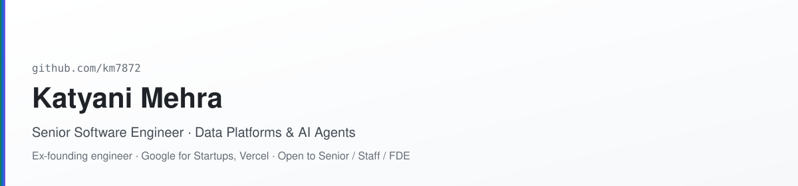

  <picture>
    <source media="(prefers-color-scheme: dark)" srcset="./assets/banner-dark.svg">
    
  </picture>

   

  

    

  <a href="https://www.linkedin.com/in/katyani-mehra/">LinkedIn</a>
  ·
  <a href="https://katyanimehra.substack.com/">Substack</a>
  ·
  <a href="mailto:katyani.mehra.dev@gmail.com">Email</a>
  ·
  Seattle, WA (open to relocation)

---

<table>
<tr>
<td width="56%" valign="top">

### About

Software engineer with ~8 years across full-stack, backend, data platforms, and production AI. I own products end to end: first customer conversation through shipping.

**Ex-founding engineer (Google for Startups, Vercel).** Open to **Senior / Staff / Forward Deployed Engineering**.

Most day-to-day work has lived on private or enterprise GitHub. This page is the public slice: writing, talks, research, and selected repos.

</td>
<td width="44%" valign="top" align="center">

</td>
</tr>
</table>

### What I actually ship

Not one job — the through-line across roles:

- **Data platforms** — multi-client ingestion (~3M records/day, 15+ connectors); donor pipelines (C# / Oracle → modular PL/SQL); inverted-index product matching
- **Production AI agents** — custom memory + RAG, tool use, in-code privacy gates; legal-doc agent pitched in Seattle; daily coding-agent contracts so tools don’t fight each other
- **Accuracy-critical backends** — maritime finance / procurement (~99% availability, queued invoice batches); tax PDF engine (Java / Spring Boot) with regression that had to match legacy output
- **Internal products people actually use** — gift-catalog + inventory adopted by ~80% of a university advancement org; local contest runner (React / PostgreSQL / Docker); Chrome extension that flags job-scam listings
- **Cloud, queues, security** — GCP (Cloud Run, Cloud Tasks, Cloud Build), AWS, Azure, RabbitMQ / SQS, IAM, SOC 2, CI that catches silent production failures
- **Applied ML / research** — custom VQ-VAE in PyTorch for continuous ASL video (BONSAI Lab, RIT), featured at ACM UIST 2025
- **Field + community** — operator office hours that fed the roadmap; GDG Cloud & ML workshops; ICPC Foundation; Women in Computing

Private take-homes and company source stay private. Ask me about the production work that cannot live in a public repo.

### Talks, writing, research

| | |
| --- | --- |
| **Talk** | Speaking at *Behind the Code: How Engineers Actually Ship Stuff* — [buildHER+](https://www.linkedin.com/feed/update/urn:li:activity:7520986724429201408/) |
| **Agents** | [How I keep production code from turning into slop with multi coding agents](https://katyanimehra.substack.com/p/how-i-keep-production-code-from-turning) |
| **Agents** | [Coding-agent roadmap](https://www.linkedin.com/feed/update/urn:li:activity:7503239444552953857/) |
| **Systems** | [How does Git compare a 200-page file?](https://katyanimehra.substack.com/p/how-does-git-compare-a-200-page-file) |
| **Research** | [Tracking ASL Gestures Using Autoencoders](https://accessible-cps.github.io/) — BONSAI Lab (RIT), ACM UIST 2025 Symposium Workshop |

More on [Substack](https://katyanimehra.substack.com/) · latest posts (auto-updated):

<!-- BLOG-POST-LIST:START -->
<!-- BLOG-POST-LIST:END -->

### Selected public work

<table>
<tr>
<td width="50%" valign="top">

**[ai-usage-bar](https://github.com/katyani-clave-ai/ai-usage-bar)** · Swift / macOS  
Menu-bar indicator for Codex + Claude usage limits.

</td>
<td width="50%" valign="top">

**[Panther AI](https://github.com/km7872/cause-i-am-a-freelancer-now)** · Node / Python  
Agent that turns legal documents into structured insights. Pitched at an AI startup event in Seattle.

</td>
</tr>
<tr>
<td width="50%" valign="top">

**[Job-scam checker](https://github.com/km7872/cause-i-cant-take-job-scams-anymore)** · Chrome extension  
Flags whether a listing looks like a scam before you waste a week on it.

</td>
<td width="50%" valign="top">

**[THT](https://github.com/ParthS33/THT)** · data / search  
Inverted-index product checker — consolidate listings, match products, analyze the catalog.

</td>
</tr>
<tr>
<td width="50%" valign="top">

**[SWEN 614 team product](https://github.com/You-re-My-Celebrity-SWEN-614-T5/SWEN614Team5ProjectClone1)**  
Team project from SWEN 614 (You’re My Celebrity).

</td>
<td width="50%" valign="top">

**[BONSAI Lab](https://github.com/bonsai-neuro-ai)** · RIT  
Neuroscience + AI org. ASL autoencoder work; I’ll pin a specific repo once it belongs on this account.

</td>
</tr>
</table>

<strong>Stack</strong>

 

**Backend:** Python, TypeScript, Node.js, Java, C#/.NET, PostgreSQL, SQL, PL/SQL  
**Cloud / security:** AWS, GCP, Azure, Terraform, CI/CD, SOC 2, IAM  
**Data:** SQS, RabbitMQ, Cloud Tasks, inverted index, semantic search  
**AI:** custom agent orchestration, tool use, agent memory, MCP, RAG, PyTorch  
**Community:** ICPC Foundation, Cloud and ML Workshop Lead (GDG Campus RIT), Women in Computing (RIT)

<strong>Education</strong>

 

M.S. Computer Science, Rochester Institute of Technology (GPA 3.72), May 2025  
B.S. Information Technology, University of Mumbai (GPA 3.97), May 2018

